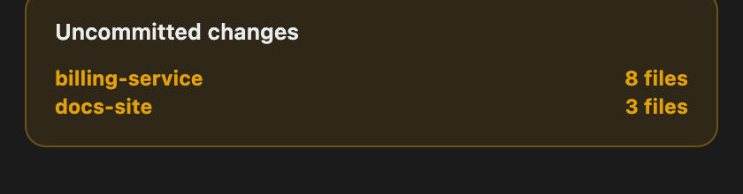
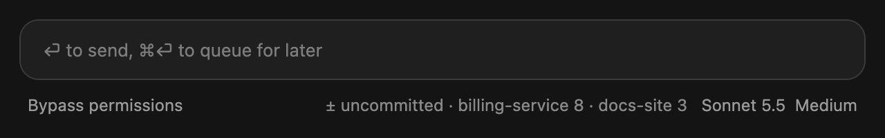

# Overview

A live side pane for Claude Code. It shows how much of your Claude and Codex limits you have used, what is filling this session's context (with a one-click Compact), which of your sessions are blocked waiting on you, which folders have uncommitted changes, and every agent running right now: subagents, spawned sessions, and Codex or any other tmux session.


It updates by itself every couple of seconds. No model is asked to write anything, so it costs nothing to leave open.

## Install

Type this at the prompt of a Claude Code session:

```
/plugin install overview --marketplace JesseWebDotCom/claude-overview
```

Answer `y` to add the marketplace, then pick a scope.

## Use

```
/overview
```

The pane opens beside the chat. Green-to-red bars are your usage, with a line saying whether you are on track. Each agent shows what it is doing and which model it runs on. Idle agents tuck under Inactive.

## Sessions

The Sessions card (collapsed by default, above Agents) lists your desktop sessions from the last day. Each is blocked on a question for you, active (it or one of its agents is working right now), or idle. A line under the bar always says how many are waiting on you, and a blocked session shows its question in amber, even when the card is collapsed, so you do not have to open each chat to find the one that is stuck. While anything is waiting on you, the whole card gets a pulsing amber border and a faint amber background, so it catches your eye from across the pane.

Sessions started by another session nest under it with a ↳, like subagents do, and a ★ marks the session you are in.


## Context: compact in time, see what is eating it

The Context card sits under your usage. It is one bar and one line, and opens into the full picture.


- **Compact when you need to.** The bar shows how full the context is and the line says how much room is left before auto-compact ("65k until auto-compact", then a nudge as it gets tight). The Compact button runs it in one click, greys out while it works, and reports how far the context dropped.
- **See what is taking the space.** Every category (system prompt, tools, MCP tools, memory files, skills, messages) has its own colour in the bar and its own row with tokens and percent. Memory files list each CLAUDE.md and AGENTS.md with its size, so you know which one is heavy.
- **Get suggestions.** A category that has grown too big gets an amber or red dot and a one-line fix: turn off MCP servers you rarely use, trim a long CLAUDE.md, disable unused skills, compact a long conversation.

## Uncommitted changes



An amber card appears between Context and Sessions only when a folder you are working in has uncommitted files. It lists one row per folder with the file count, the biggest first, and it disappears again once everything is committed. It checks with `git status`, at most every 10 seconds, and never takes a git lock. The same summary ("± uncommitted · home 8") is pinned in the status line under the prompt.



## Good to know

- Codex and Claude usage appear only when there is a reading. No Codex, no Codex card.
- A tmux session started by `wt.sh` (for example a Codex run) shows under the Claude session that owns it, with its run state (FAILED, DIED, TIMEOUT turn the row red). This reads `data-scratch/sessions/*.json` in your repos.
- Everything is read from your own machine (tmux, `~/.claude`, `~/.codex`). Nothing is sent anywhere.
- macOS only for now, with tmux installed to see tmux sessions.

MIT licensed.
