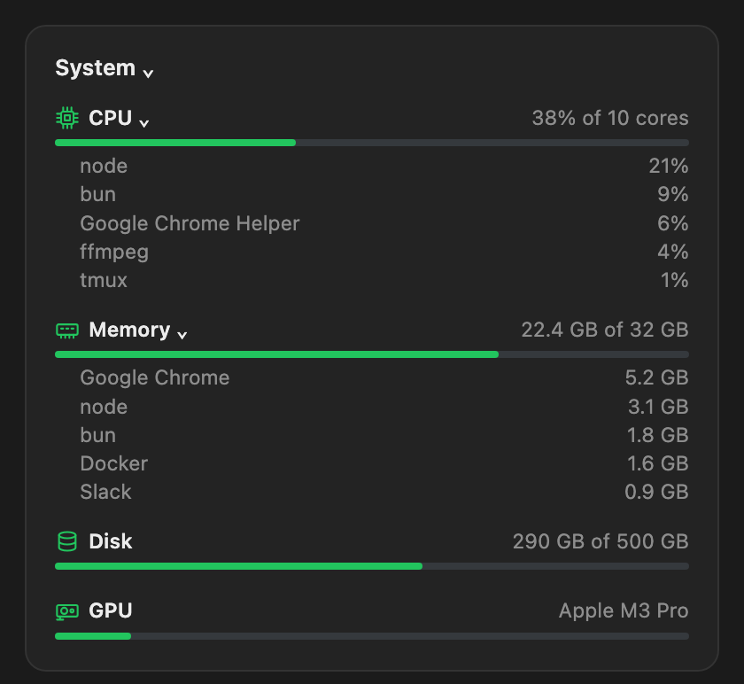

# Overview

A live pane beside Claude Code: machine health, repo changes, Claude and Codex limits, context, sessions waiting on you, and every running agent.


It refreshes every few seconds, costs no tokens, and reads only your own machine. Nothing is sent anywhere.

## Install

```
/plugin install overview --marketplace JesseWebDotCom/claude-overview
```

Answer `y` to add the marketplace, pick a scope, then run `/overview`.

## The cards

- **System.** CPU, memory, disk and GPU percents. Open it for bars and the top five processes.
- **Changes.** Files, lines added and removed, an **Open** button and **Create PR**.
- **Subscriptions.** Claude and Codex usage and whether you are on track.
- **Context.** How full it is, with a one-click **Compact**. Open it for every category.
- **Sessions.** Which sessions are waiting on you. **▶** runs the step a session asks for.
- **Agents.** Every running agent, with its model and what it is doing.

 

## Choose cards

| Command | Does |
|---|---|
| `/overview hide agents` | Hide a card (or `all`) |
| `/overview show agents` | Show it again |
| `/overview agents context` | Put these first, in order |
| `/overview reset` | Every card, default order |

Saved in `~/.claude/overview.json`.

macOS only for now. Buttons may need a second click (a quirk of Claude mods). MIT licensed.
