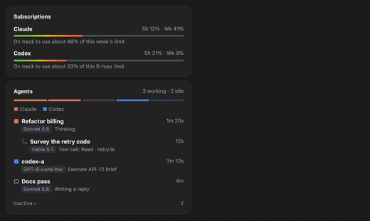
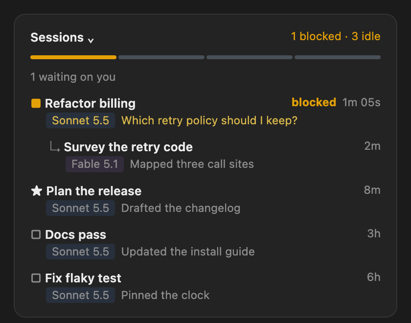
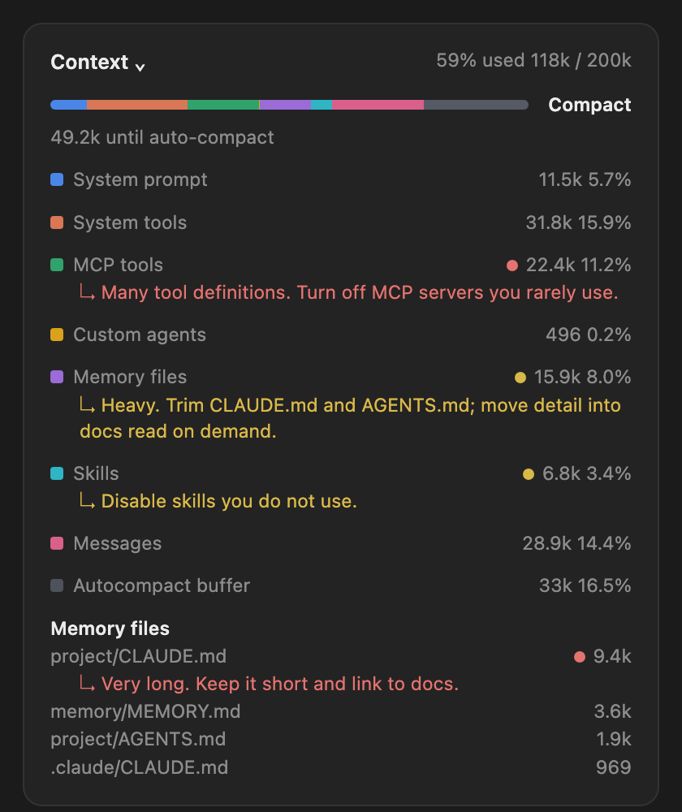
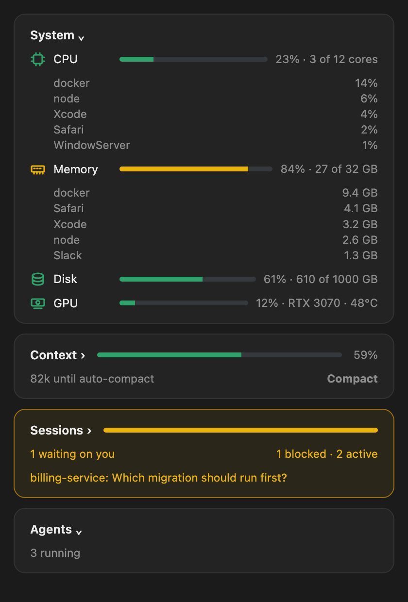
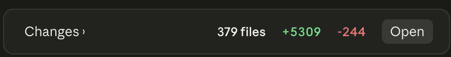
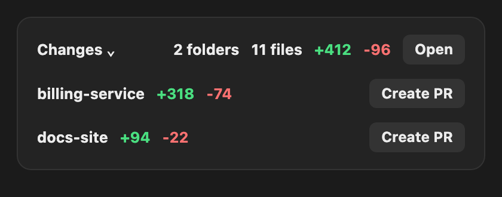
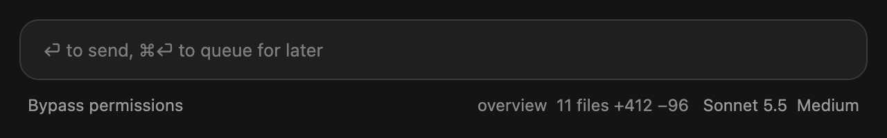

# Overview

A live side pane for Claude Code. It shows how much of your Claude and Codex limits you have used, what is filling this session's context (with a one-click Compact), which of your sessions are blocked waiting on you, which folders have changes and how big they are, and every agent running right now: subagents, spawned sessions, and Codex or any other tmux session.




It updates by itself every couple of seconds. No model is asked to write anything, so it costs nothing to leave open.

## Install

Type this at the prompt of a Claude Code session:

```
/plugin install overview --marketplace JesseWebDotCom/claude-overview
```

Answer `y` to add the marketplace, then pick a scope.

## Use

```
/overview
```

The pane opens beside the chat. Green-to-red bars are your usage, with a line saying whether you are on track. Each agent shows what it is doing and which model it runs on. Idle agents tuck under Inactive.

## Sessions

The Sessions card (collapsed by default, above Agents) lists your desktop sessions from the last day. Each is blocked on a question for you, active (it or one of its agents is working right now), or idle. A line under the bar always says how many are waiting on you, and a blocked session shows its question in amber, even when the card is collapsed, so you do not have to open each chat to find the one that is stuck. While anything is waiting on you, the whole card gets a pulsing amber border and a faint amber background, so it catches your eye from across the pane.

Sessions started by another session nest under it with a ↳, like subagents do, and a ★ marks the session you are in.



## Context: compact in time, see what is eating it

The Context card sits under System. Its first line holds the title, the bar and the percent; the second says how much room is left. It opens into the full picture.



- **Compact when you need to.** The bar shows how full the context is and the line says how much room is left before auto-compact ("65k until auto-compact", then a nudge as it gets tight). The Compact button runs it in one click, greys out while it works, and reports how far the context dropped.
- **See what is taking the space.** Every category (system prompt, tools, MCP tools, memory files, skills, messages) has its own colour in the bar and its own row with tokens and percent. Memory files list each CLAUDE.md and AGENTS.md with its size, so you know which one is heavy.
- **Get suggestions.** A category that has grown too big gets an amber or red dot and a one-line fix: turn off MCP servers you rarely use, trim a long CLAUDE.md, disable unused skills, compact a long conversation.

## System: is the machine healthy

The System card is the first card in the pane. Collapsed, it is one line: an icon (chip, memory stick, disk, graphics card) and a percent each for CPU, memory, disk and GPU, the icon green below 80%, amber from 80% and red from 92% (CPU 95%, disk 85% and 95%). Click the title to see each meter with its bar and numbers: cores in use, gigabytes of memory and disk, and the GPU model (plus memory and temperature when `nvidia-smi` is present). CPU and Memory each list their top five processes (click the name to fold them away), grouped by program name, so you can see what is eating the machine. A Mac that macOS has slowed down for heat says so. It is sampled every 5 seconds with `ps`, `vm_stat`, `df` and `ioreg` on a Mac, and `/proc` and `nvidia-smi` on Linux, so nothing needs installing. A meter whose source is missing is left out rather than shown as zero.



## Show, hide or reorder cards

By default cards run in this order: System, Changes, Subscriptions, Context, Sessions, Agents. Context and Sessions are two lines each, with the bar beside the title. In Sessions the second line shows the waiting state on the left and the summary on the right.

Type `/overview hide agents` or `/overview show agents` (cards: subscriptions, system, context, changes, sessions, agents; `all` works too). The choice is kept in `~/.claude/overview.json`, for example `{"hidden":["sessions"]}`, which you can also edit by hand.

To reorder, list the cards you want on top in order: `/overview agents context system` (or `/overview order agents context system`). Any card you leave out follows in its usual order, so `/overview agents` just puts Agents first. `/overview first agents` and `/overview last agents` move one card to the top or the bottom. `/overview reset` shows every card again and restores the default order. The order is kept in the same file, for example `{"hidden":[],"order":["agents","system"]}`.

## Changes



The Changes card sits under System and appears only when a folder you are working in has changes. The header always shows the total: how many files, lines added in green and lines removed in red, plus an **Open** button that asks Claude to open its own Changes pane. Like Claude's own count, a folder is measured against `origin/main` for its branch plus anything uncommitted.

The card is collapsed by default. Click the title to list one row per folder, biggest first, each with its own +/- and a **Create PR** button that opens a pull request for that folder.



A failed Open or Create PR shows its reason in red under the rows. The card disappears once everything is committed and pushed. It checks with `git`, at most every 10 seconds, and never takes a git lock. The same summary is pinned in the status line under the prompt.



## Good to know

- Agents and sessions are listed alphabetically, each parent followed by its children, so rows never jump around as their state changes. Colour and the amber Sessions border show what is waiting on you.
- A session stays "working" through a long tool call (a test run, a build) for up to 15 minutes, and its row shows what the call is.
- Codex and Claude usage appear only when there is a reading. No Codex, no Codex card.
- A tmux session started by `wt.sh` (for example a Codex run) shows under the Claude session that owns it, with its run state (FAILED, DIED, TIMEOUT turn the row red). This reads `data-scratch/sessions/*.json` in your repos.
- Everything is read from your own machine (tmux, `~/.claude`, `~/.codex`). Nothing is sent anywhere.
- macOS only for now, with tmux installed to see tmux sessions.

MIT licensed.
